<div align="center">

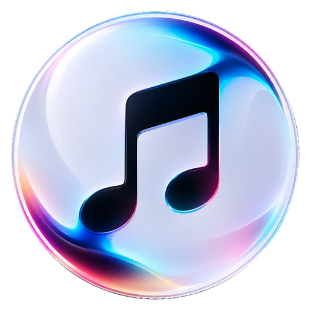

# Glaze Music

**Your music, one player.**

A desktop music player for your music — your files, your playlists, your library, in one place.

Built with Electron and React. Windows installer, no account required for local playback.

[](https://github.com/shami60/glaze-music/releases/latest)
[](https://github.com/shami60/glaze-music/actions/workflows/ci.yml)
[](#install)
[](package.json)

**[Download the installer →](https://github.com/shami60/glaze-music/releases/latest)**

</div>

<div align="center">

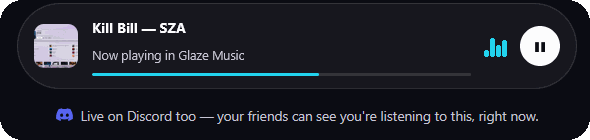

</div>

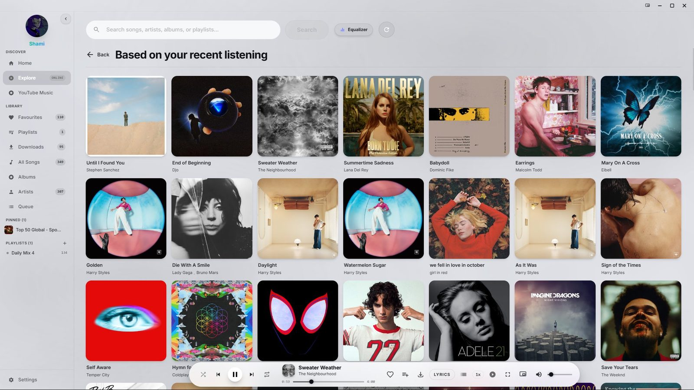

---

## What is Glaze Music?

Most players make you choose. Local files or streaming. Your library or the cloud. Glaze Music keeps both in the same place: point it at a folder of music and it indexes everything into SQLite, then sign in to YouTube Music and your library comes with you — your liked songs, your playlists, your mixes and artist pages, right next to your own files.

It is a real desktop app, not a wrapper around a website. Playback, the library index, downloads and lyrics all run locally. Your listening history stays on your machine.

> **Not affiliated with YouTube or Google.** Glaze Music is an independent client. See the [disclaimer](#disclaimer).

---

## Features

### Your files and YouTube Music, side by side

**Sign in to YouTube Music and your library comes with you — your liked songs and your playlists, next to your own files.**

Point it at one or more folders and it scans them, reads ID3 tags and builds a searchable index. Albums, artists and playlists are derived from the files themselves — no metadata service, no upload.

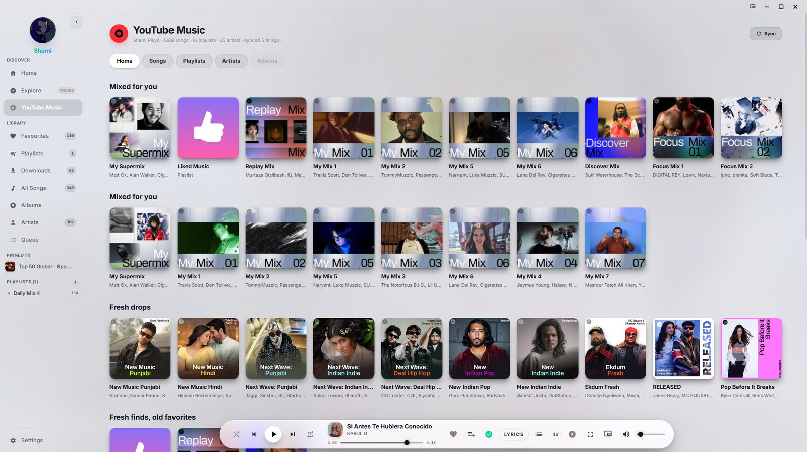

### Lyrics that follow the vocal

**The full-screen player highlights lyrics word by word, as the song is sung.**

Paced by syllable count rather than character length — so a long word like "extraordinary" gets the time it needs, and a short one does not sit lit for a second. Instrumental breaks no longer drag the highlight along, right-to-left lyrics render correctly, and any line can be translated in place.

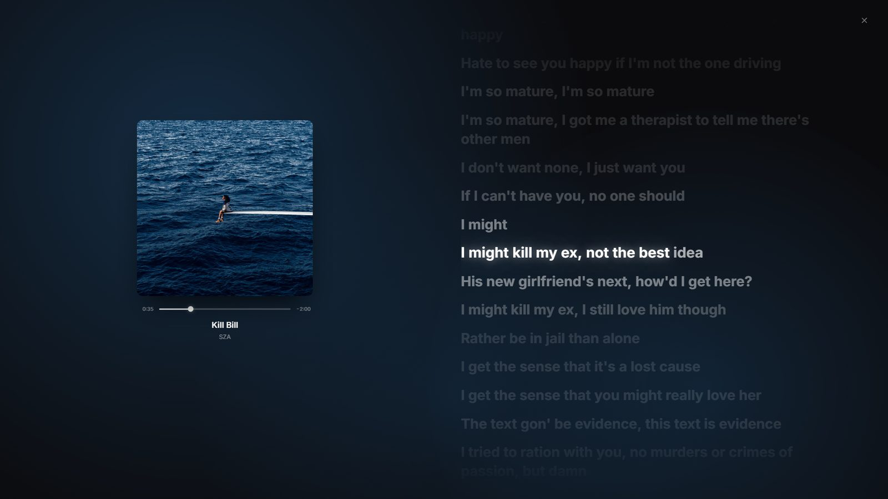

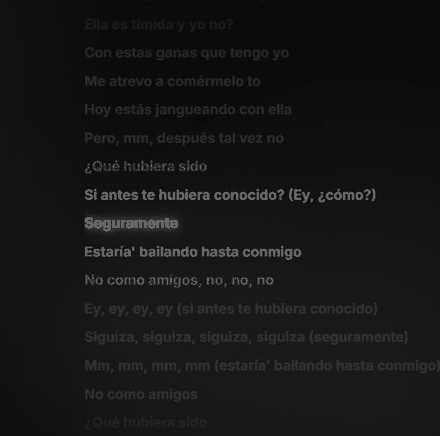

### Pin any playlist to the sidebar

**Hover a playlist anywhere and pin it — it stays in your sidebar, in the view it came from.**

Works on YouTube Music, Explore, and artist pages. It reopens in the view it came from, not whichever tab happens to be active.

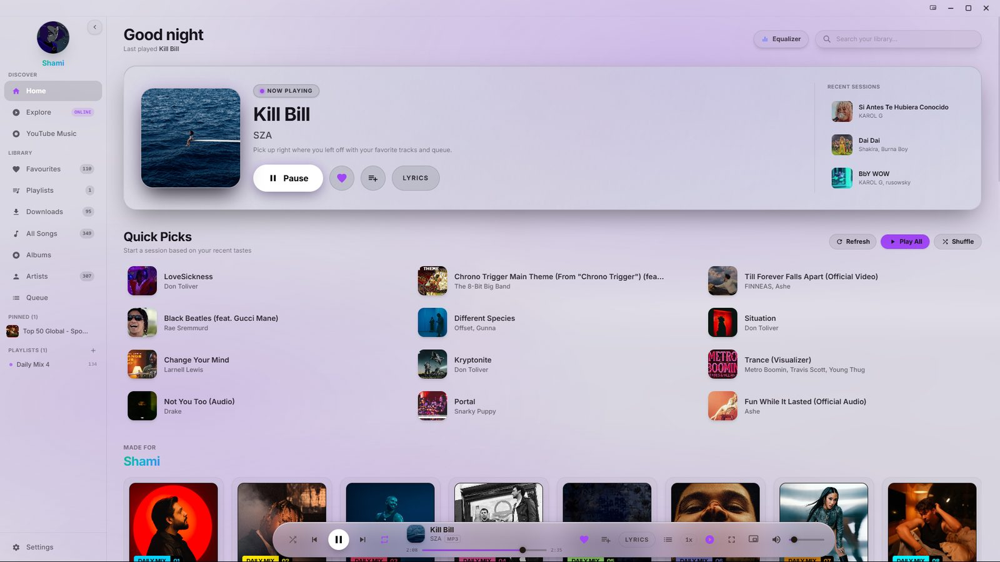

### A real 10-band equalizer

**Ten bands, seven presets — and it tells you the truth when you change one.**

Ten bands from 32 Hz to 16 kHz. Change a band by hand and the control reads **Custom** instead of pretending you're still on a preset. Presets survive a restart.

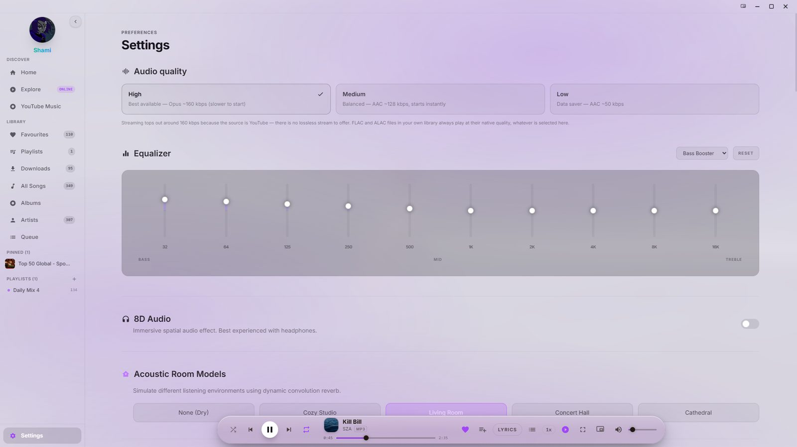

### Explore, built from what you actually play

**Artists you listen to, filters for mood and genre, trending charts, and recommendations from your recent history.**

No sign-in needed for this side.

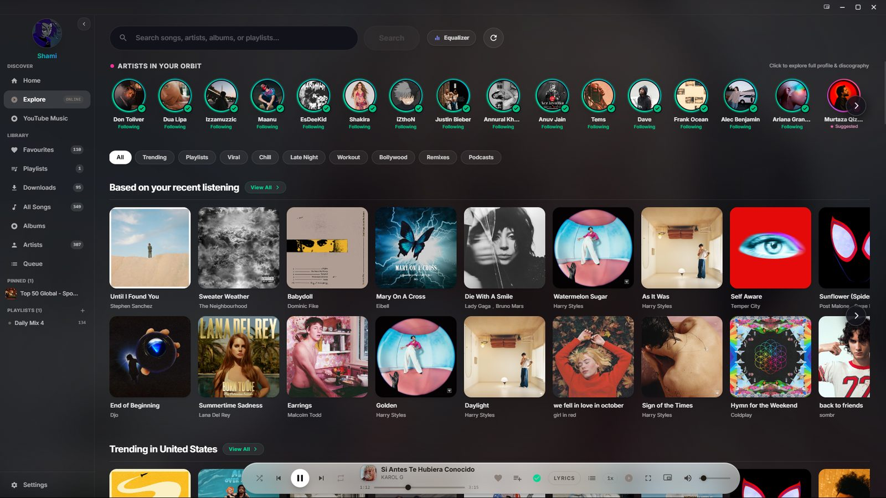

### Artist pages worth opening

**Discography, top tracks, related artists, and every appearance the artist makes in your library — on one page.**

Without leaving playback.

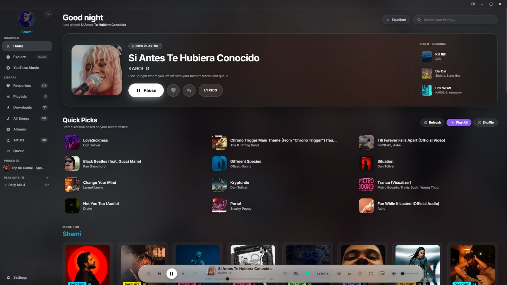

### Your friends can see what you're listening to

**Glaze Music shows up on Discord — so when you're listening, your friends can see it too.**

The track, the artist, the real cover art and a live progress bar, right in Discord. No bot, no account linking, nothing sent to a server. It connects automatically when Discord is running and does nothing when it is not.

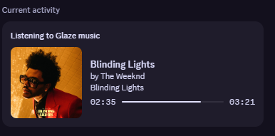

### A mini player for when the full window is too much

**Shrink the whole app down to a narrow strip and keep it beside whatever else you're doing.**

It is the same player, not a cut-down version: full transport — shuffle, skip, play/pause, plus elapsed and remaining time. **LYRICS** opens the full-screen lyrics and keeps your place. Volume and favourite without going back to the main window. It follows you across virtual desktops.

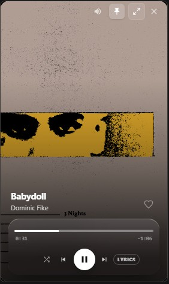

### The rest of it

- **Offline downloads** — save tracks and albums, cover art included, into your library
- **Queue with history** — reorder, play next, jump back
- **8D spatial audio**, room reverbs, crossfade and playback speed
- **Light and dark themes** — Daylight, Sandstone and Liquid Glass, plus your own accent colour
- **Online updates** — checks on launch, installs on quit, and only downloads the parts that changed

---

## Install

1. Download **[Glaze Music from Releases](https://github.com/shami60/glaze-music/releases/latest)**
2. Run the installer — per-user install, no admin rights needed
3. Point it at a folder of music, or sign in to YouTube Music to bring your liked songs and playlists with you

> **Windows will warn you.** The installer is not code-signed yet, so SmartScreen shows
> *"Windows protected your PC — Unknown publisher"*. Choose **More info → Run anyway**. Signing is the
> only reason for that warning.

`yt-dlp.exe` ships inside the installer, so downloads work out of the box. Nothing else to install.

---

## Build from source

Requires **Node.js 22** or newer, and Windows for the installer target.

```bash
git clone https://github.com/shami60/glaze-music.git
cd glaze-music
npm install
npm run dev          # hot-reloading dev build
```

To produce an installer locally:

```bash
npm run release      # builds and packages into dist-electron/
```

> `npm install` relies on the `overrides` block in `package.json`. Removing it makes every install fail
> with `Invalid Version:` — `discord-rpc` pulls a dependency from a raw git URL.

---

## How it is put together

| Area | Choice |
|---|---|
| Shell | Electron 36 — `contextIsolation` on, `sandbox` on, no node in the renderer |
| UI | React 18 + Tailwind, CSS-variable theming |
| Library index | SQLite via `better-sqlite3`, chunked writes |
| Streaming | Innertube client for YouTube Music; `yt-dlp` for high-quality audio |
| Updates | `electron-updater` against GitHub Releases, differential via blockmaps |
| CI | GitHub Actions — lint, logic checks and a build on every push; tag-driven releases |

Two React contexts are kept deliberately separate: transport and metadata, and a ~4 Hz playback-time
context, so position ticks do not re-render every consumer.

---

## FAQ

**Is it free?** Yes. No account, no telemetry, no upsell.

**Does it work without signing in to YouTube Music?** Yes. The local library, playlists, favourites,
equalizer, lyrics for local files and downloads all work offline. Only the streaming shelves need an
account.

**What audio quality does it stream?** Around 160 kbps, because the source is YouTube — there is no
lossless stream to offer. Files in your own library always play at their native quality.

**Can I use it on macOS or Linux?** Not today. The build targets Windows (NSIS). The Electron code is
not Windows-specific, but nothing else is tested.

**Where is my data?** In `%APPDATA%\glaze-music` on your machine. The library index, playlists and
settings never leave it.

---

## Contributing

Issues and pull requests are welcome. Before opening a PR, run what CI runs:

```bash
npm run lint
npm run test:backup
npm run test:art
npm run build
```

The ESLint baseline is **0 errors / 77 warnings**. A new warning usually means dead code or a stale
dependency array — worth looking at rather than adding to the pile.

For anything touching releases or updates, read **[UPDATES.md](UPDATES.md)** first.

---

## Disclaimer

Glaze Music is an independent project, not affiliated with, endorsed by, or connected to YouTube or
Google. It is a client for content you have access to; it does not host, mirror or redistribute any
audio. Downloading content may be subject to the terms of the service it comes from — you are
responsible for how you use it.

---
